# Add your app

You built an app, maybe with an AI. Add it to the cards and anyone can run it with one prompt, on their own machine, in the same tested way. You keep your app, your licence and your repository: a card only describes how to run it.

We tried it ourselves with a club noticeboard that an AI wrote. Here is its card: [club-noticeboard](club-noticeboard), with who looks after it and the day it was tested.

You don't need a card to run your app on Edgible. This page is for the last step, sharing it. To put an app on Edgible and keep it private, ask your AI, as in [Use cards with your AI](https://cards.edgible.org/ai/).

## What you need

- **An Edgible account**, free during the beta, with no credit card. A card is tested on your own Edgible before it reaches us, so nothing of ours is touched.
- **A computer that can stay on, or a small cloud server** in your own account, signed in to Edgible. It is also where you test your card. A spare computer or a small virtual machine will do.
- **An AI that can run commands.** We recommend Claude Code. The [edgible-cards skill](https://github.com/edgible-org/card-kit/tree/main/skills/edgible-cards) does the work: [install it](https://cards.edgible.org/ai/) once.

## The steps

1. **Tell your AI about your app.** "I built an app at (your repository or folder). Help me add it to the Edgible cards." It reads your app and tells you plainly what must change and what would make it better. It changes nothing in your app without asking.
2. **Fix what is missing.** It offers to build each missing piece. You make the calls.
3. **Test it on your own Edgible.** Your AI runs the card's whole lifecycle on your machine. The result goes into your pull request.
4. **Open a pull request** to [edgible-org/cards](https://github.com/edgible-org/cards), from a fork. Your AI asks you first: anything that leaves your machine needs your yes.
5. **Edgible reads it and tests it again** on our own machines. A person does this by hand, so it is not instant.
6. **It's listed**, with who looks after it. After that, the nightly regression keeps testing it.

## What a card needs

The skill runs `check-app` on your app and reads you the result. You can run it yourself: it is in [card-kit](https://github.com/edgible-org/card-kit).

**Required**

- A public image with a version tag, built for both Intel and Apple Silicon
- A licence that lets others run it
- Its settings written down
- Its port, and where its data lives
- No secrets in the code
- Someone who answers for it: a GitHub name

**Nice to have**

- A healthcheck
- Not running as root
- Secrets that can come from files
- A note on how to back it up
- An icon: a square logo, which your AI can draw for you. Without one, the catalog shows the Edgible symbol
- Tagged releases
- No default password in the files

## Who answers for it

Every card shows who looks after it. Put your GitHub name on yours and it says **Stewarded by you**: you review changes to it and fix it if its test fails. Prefer not to? It can be listed with **No steward**. It is still tested every night, and if its test fails, it is shown dimmed until it passes.

## With an agent that works on its own

An agent can do every step. `check-app --json` tells it what is missing until nothing required is left. It asks you only for what is yours to decide, such as the licence and who the steward is. Then it opens the pull request from a fork. It starts from the [skill](https://github.com/edgible-org/card-kit/tree/main/skills/edgible-cards), the [contributing guide](https://github.com/edgible-org/cards/blob/main/CONTRIBUTING.md) and [llms.txt](https://www.edgible.ai/llms.txt).

## Stuck, or not sure it is ready?

Tell us what you built and where you got to: [open an issue](https://github.com/edgible-org/cards/issues/new), or write to us on the [contact page](https://www.edgible.ai/contact/).
