# Edgible for Contributors

You built an app, maybe with an AI. Turn it into a card, and anyone can run it with one prompt, on a machine of their own, the same tested way. You keep your app, your licence and your repository: a card only describes how to run it. Every playbook begins with [Get Edgible running](../get-edgible-running/).

We tried it ourselves with a club noticeboard that an AI wrote. Here is [its card](https://cards.edgible.org/club-noticeboard/), with who looks after it and the day it was tested.

The chapters:

1. <svg><use href="../icons.svg#cube"/></svg>**[Make your app a card](../make-your-app-a-card/):** your AI checks your app, tells you what a card needs, and builds what's missing.
2. <svg><use href="../icons.svg#share"/></svg>**[Test it and share it](../test-it-and-share-it/):** a test on your own Edgible, a pull request, and a listing with who looks after it.

You don't need a card to run your own app on Edgible: ask your AI to publish it, and it can stay private. These chapters are for sharing it.

**An AI agent working on its own can do every step.** It asks you only for what is yours to decide, such as the licence and who looks after the card. It starts from the [Edgible skill](https://github.com/edgible-org/card-kit/tree/main/skills/edgible-cards) and the [contributing guide](https://github.com/edgible-org/cards/blob/main/CONTRIBUTING.md).
